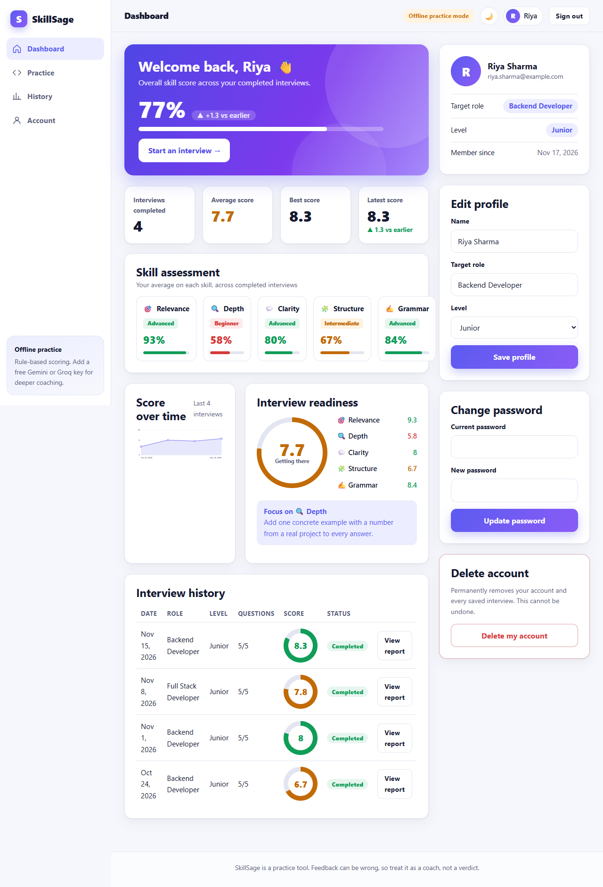
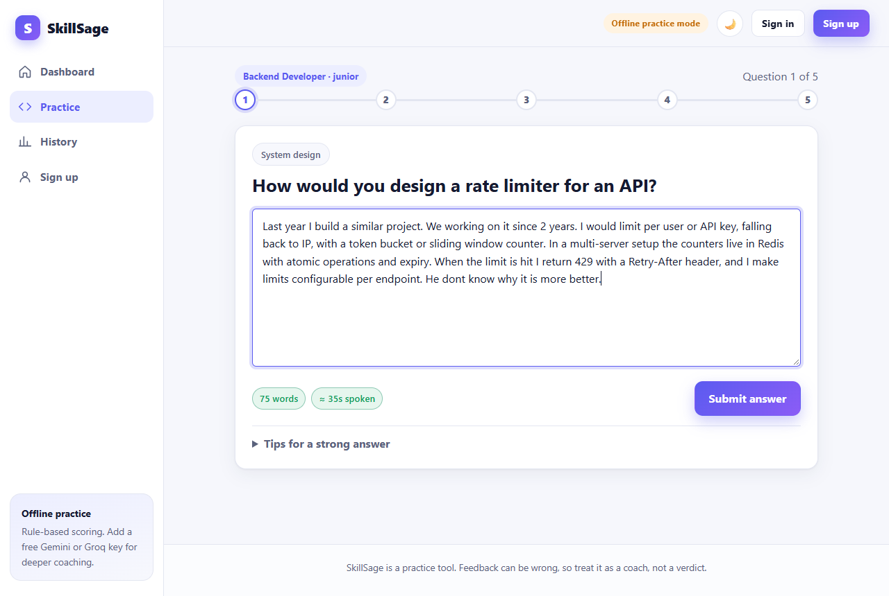
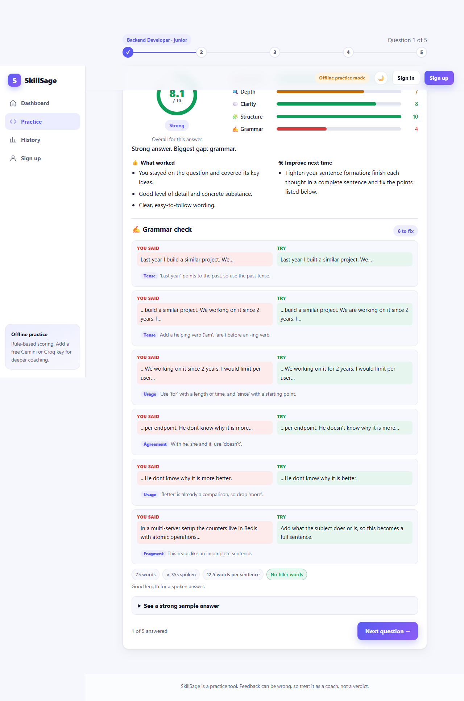
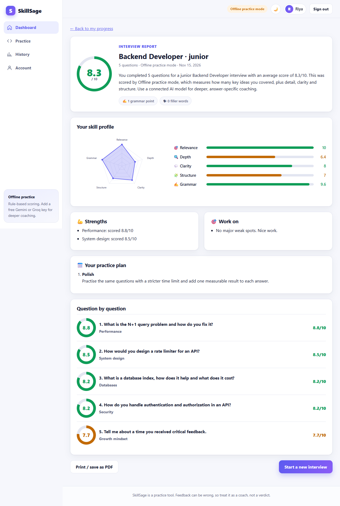
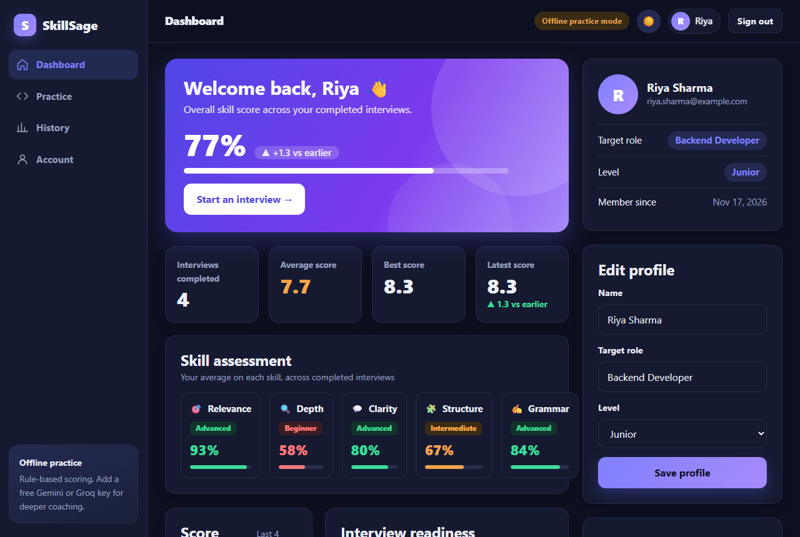

# SkillSage

**An AI mock-interview coach.** Pick a role, answer realistic questions the way you would say them out loud, and get a score and specific coaching on every answer, including **grammar**. A final report and a progress dashboard show where to improve next.


Built with **Python, Flask and SQLAlchemy**, using a **free hosted LLM (Google Gemini or Groq)**, an optional **local model backup (Ollama / llama.cpp)**, and an **offline mode** that needs no key and no AI, so it runs anywhere.



| Answering a question | Feedback with grammar fixes |
|---|---|
|  |  |

| Final report | Dark mode and mobile |
|---|---|
|  |  |

## Highlights

- **Five scored skills** on every answer: relevance, depth, clarity, structure and **grammar**. All five count toward the overall score.
- **Grammar = proper sentence formation, judged as spoken English.** It flags incomplete sentences, run-ons, subject-verb agreement ("he don't"), tense slips ("last year I build"), missing helping verbs ("we working"), word usage ("discuss about", "more better"), a/an and repeated words. Each issue is shown as **You said** vs **Try**, with the reason. Spelling, capitalisation, punctuation and casual speech ("gonna") are deliberately **not** penalised.
- **Delivery facts:** word count, estimated speaking time, words per sentence and filler words ("um", "you know").
- **Accounts and history:** sign up to save every interview, see your score trend, skill averages and a "focus on" tip for your weakest skill. Guests can finish an interview and save it after signing in.
- **Dashboard UI:** sidebar layout, light and dark themes, responsive down to a phone, live word and speaking-time meters, and a printable report.
- **Resilient by design:** free API first, a local model as automatic backup when the quota runs out, and a rule-based offline mode as the last resort.

## What it demonstrates

For reviewers skimming this repo, the parts worth a look:

| Area | Where |
|---|---|
| Provider abstraction (Gemini, Groq, local, offline) and automatic fallback | `app/llm/` |
| Strict validation of untrusted model output (JSON parsing, clamping, length limits) | `app/llm/parsing.py` |
| Prompt-injection defence (candidate text fenced as data) | `app/llm/prompts.py` |
| Rule-based grammar engine with precision-over-recall rules and "must not flag" tests | `app/grammar.py`, `tests/test_grammar.py` |
| Auth: scrypt hashing, HttpOnly SameSite cookies, CSRF origin check, rate limiting, ownership checks | `app/services/auth.py`, `app/ratelimit.py` |
| Content-Security-Policy with no inline scripts, and a test that fails if any script uses `innerHTML` | `app/__init__.py`, `tests/` |
| SQLAlchemy models and progress statistics | `app/db.py`, `app/services/history.py` |
| 112 tests, including a real HTTP fake of an Ollama server | `tests/` |

## How it works

1. Choose a **role**, **level** and number of questions, and optionally add your **resume** (PDF or text).
2. SkillSage asks one question at a time. In AI mode the questions adapt to your role, level, resume and how you are doing.
3. After each answer you get scores, feedback, grammar fixes and a strong sample answer.
4. At the end you get the report. If you are signed in it is saved to your profile.

## Three ways to run the brain

| | AI mode (Gemini / Groq) | Local model backup | Offline practice mode |
|---|---|---|---|
| Needs | a free API key | Ollama or llama.cpp and a small model | nothing |
| Questions | generated for your role, level and resume | same | built-in bank: 7 tracks plus behavioural |
| Scoring | the model, using a fixed rubric | the model, using the same rubric | transparent rules (key ideas, detail, clarity, structure, grammar) |
| Can judge correctness? | mostly, but it can be wrong | weaker, especially on 1B-3B models | no |

The app picks automatically and shows the active mode in the header. If the free API fails or its quota runs out, it switches to the local model when one is configured.

## Quick start

```bash
git clone https://github.com/rakshakdatta/SkillSage.git
cd SkillSage

python -m venv .venv
# Windows:  .venv\Scripts\activate        macOS/Linux:  source .venv/bin/activate
pip install -r requirements.txt

python run.py
```

Open **http://127.0.0.1:5055**. With no key it starts in offline practice mode and creates a local SQLite database in `instance/` on first run.

### Turn on AI mode (free)

1. Create a free key at [Google AI Studio](https://aistudio.google.com/apikey) (Gemini) or the [Groq console](https://console.groq.com/keys).
2. Copy `.env.example` to `.env` and set the key:

```ini
GEMINI_API_KEY=your-key-here
# or
GROQ_API_KEY=your-key-here
```

3. Restart `python run.py`. The header badge changes to the model name. Never commit `.env`; it is git-ignored.

### Optional: a local model as backup

When the free key runs out of quota or is rejected, SkillSage can switch to a model on your own machine, with no key and no data leaving the computer. Install [Ollama](https://ollama.com) (or llama.cpp), pull a small model and set it in `.env`:

```ini
LOCAL_LLM_MODEL=gemma2:2b      # 1B-3B need ~4-6 GB free RAM; llama3.1:8b needs ~8 GB
```

After a failure the hosted model is skipped for a minute so requests are not slowed down. Small models are weaker at scoring and sometimes return malformed JSON; SkillSage retries once and then shows an error rather than a made-up score.

## Configuration

| Variable | Default | Purpose |
|---|---|---|
| `LLM_PROVIDER` | `auto` | `auto`, `gemini`, `groq`, `local` or `offline`. `auto` uses Gemini if its key is set, else Groq, else a local model if chosen, else offline. |
| `GEMINI_API_KEY` / `GEMINI_MODEL` | empty / `gemini-2.5-flash` | Gemini settings. Model names change over time, so adjust if needed. |
| `GROQ_API_KEY` / `GROQ_MODEL` | empty / `llama-3.3-70b-versatile` | Groq settings. |
| `LOCAL_LLM_MODEL` | empty | Local model, e.g. `gemma2:2b`, `llama3.2:3b`, `llama3.1:8b`. With a Gemini/Groq key it is the **backup**; alone it is the main model. |
| `LOCAL_LLM_URL` | `http://127.0.0.1:11434/v1` | Any OpenAI-compatible local server: Ollama, llama.cpp `llama-server` (`:8080/v1`), LM Studio. |
| `LOCAL_LLM_TIMEOUT_SECONDS` | `180` | Small CPU-only models can be slow. |
| `LLM_TIMEOUT_SECONDS` | `45` | Per-request timeout for hosted AI. |
| `DATABASE_URL` | SQLite file in `instance/` | Any SQLAlchemy URL, e.g. MySQL or PostgreSQL (install its driver). |
| `SECRET_KEY` | generated once, kept in `instance/.secret_key` | Signs the login cookie. Set your own in production. |
| `COOKIE_SECURE` | `false` | Set `true` when served over HTTPS. |
| `AUTH_RATE_LIMIT` | `10` | Sign-in and sign-up attempts per 5 minutes per visitor. |
| `RATE_LIMIT_PER_MINUTE` | `40` | POST requests per visitor per minute, which protects your free AI quota. |
| `PORT` | `5055` | Server port. |

## Architecture

```text
app/
├── __init__.py            app factory: security headers, CSRF origin check, rate limiting, error handling
├── config.py              settings from environment variables
├── db.py                  SQLAlchemy models: users, interviews, answers
├── models.py              Question, Evaluation, Session ... (plain dataclasses)
├── grammar.py             sentence-formation rules + delivery facts (spoken-English aware)
├── llm/
│   ├── base.py            provider interface + shared JSON-over-HTTP logic (retry once on bad JSON)
│   ├── prompts.py         prompts (candidate text is fenced as untrusted data)
│   ├── parsing.py         strict validation of model output: clamps scores, caps lengths
│   ├── gemini.py groq.py  hosted REST clients (no SDKs)
│   ├── local.py           local model via any OpenAI-compatible server (Ollama, llama.cpp, LM Studio)
│   ├── fallback.py        hosted model first, local backup on failure, with a cool-down
│   ├── offline.py         question bank + rule-based scoring
│   └── factory.py         picks the provider
├── services/
│   ├── interview.py       interview flow, ownership checks, report (with a score-based fallback)
│   ├── auth.py            sign-up, sign-in, profile changes (hashed passwords)
│   ├── history.py         saves interviews, builds progress statistics
│   ├── resume.py          PDF/text extraction and removal of contact details
│   └── store.py           in-memory live sessions with expiry and a size cap
├── routes/                JSON API + pages
├── templates/ static/     server-rendered pages and vanilla JS (no build step, no inline scripts)
tests/                     112 tests
```

Providers share one small interface (`first_question`, `review_answer`, `final_report`), so adding another model means writing one `_complete()` method.

### API

| Method | Path | Purpose |
|---|---|---|
| `GET` | `/api/health`, `/api/roles` | status, active provider, suggested roles |
| `POST` | `/api/auth/register`, `/api/auth/login`, `/api/auth/logout` | accounts |
| `GET` | `/api/auth/me` | the signed-in user |
| `GET` `PATCH` `DELETE` | `/api/profile` | stats and recent history, edit profile, delete account |
| `POST` | `/api/profile/password` | change password |
| `GET` | `/api/history`, `/api/history/<id>` | saved interviews |
| `POST` | `/api/resume` | upload a PDF or .txt, returns cleaned text |
| `POST` | `/api/sessions` | start an interview `{role, level, total, resume_text}` |
| `GET` | `/api/sessions/<id>` | current state (lets a page reload resume) |
| `POST` | `/api/sessions/<id>/answer` | submit an answer, get the evaluation and the next question |
| `GET` | `/api/sessions/<id>/report` | the final report |
| `POST` | `/api/sessions/<id>/save` | save a finished guest interview to your account |

## Design decisions

- **One model call per turn.** Answering evaluates the answer *and* asks the next question in a single request, so an interview of N questions costs N + 2 calls. This keeps the free tier usable.
- **Grammar rules favour precision over recall.** A missed error is better than a false alarm, so the rules are conservative and each one has tests, including tests that spelling, capitalisation and casual speech are *not* flagged.
- **Model output is untrusted.** It is parsed as JSON, validated, clamped and length-limited. The UI inserts it with `textContent`, never as HTML, a test fails the build if any script uses `innerHTML`, and a strict Content-Security-Policy is set (no inline scripts or styles).
- **Candidate text is data, not instructions.** Answers and resumes are wrapped in tags and the system prompt tells the model to ignore instructions inside them.
- **Privacy.** Emails, phone numbers and links are removed from resumes before anything is sent to an AI service. Resume text is kept in memory only, never in the database.
- **Account security.** Passwords are hashed (scrypt), sign-in errors do not reveal whether an email exists, auth endpoints are rate limited, the session cookie is `HttpOnly` and `SameSite=Lax`, cross-site POSTs are rejected, and one user can never read another user's interviews.
- **Failures don't lose work.** If an evaluation call fails, nothing is recorded and you can retry. If only the final summary fails, you still get a report built from your scores. A database error never breaks a live interview.

## Tests

```bash
pip install -r requirements-dev.txt
pytest
```

112 tests cover the scoring rules, every grammar rule (including the "must not flag" cases), the interview flow, validation, rate limiting, resume handling, accounts and security (hashing, cookies, CSRF, ownership, account deletion), history and progress statistics, the Gemini and Groq clients against **fake HTTP responses** (retry on bad JSON, 429 and auth handling, key never leaking into errors or URLs, prompt-injection fencing), and the local-model provider and fallback against a **real local HTTP server** that imitates Ollama.

## Status and limitations

I want this to be an honest portfolio piece, so:

- The **Gemini and Groq clients have been tested against simulated responses, not against the live services**, because no API key was available during development. Check the model names in `.env` against the provider's current list when you first run it.
- The **local-model backup was tested against a real HTTP server that imitates Ollama's protocol, not against a real Gemma or Llama model.** Expect weaker scoring from 1B-3B models.
- **Offline mode** rewards covering the right ideas and applies grammar rules; it cannot tell whether an answer is *correct*. Its grammar rules cover common structural errors, not every possible one.
- AI feedback can be wrong or too generous. Treat it as a coach, not a verdict.
- An **unfinished** interview is lost if the server restarts (finished ones are saved). This is a development server (`python run.py`); use a production WSGI server to deploy.
- No password reset or email verification yet, and no audio or video.
- The dashboard in the screenshots shows seeded demo data.

## Roadmap

- [ ] Password reset and email verification
- [ ] Speech-to-text answers and speaking-pace feedback
- [ ] Database migrations (Alembic) and a production deployment guide
- [ ] More tracks (mobile, ML, product) and company-style rounds
- [ ] Optional integration with the [HustleNest](https://github.com/rakshakdatta/HustleNest) student platform

## License

MIT
